  
  
  
  
  
  

I build the part of AI that comes **after** the notebook: routing, memory, evals, retries, auth and deploys. Most of my work is multi-agent systems wired into real backends, tested, and running live.

 

  
  
  
  
  
  

<b>More things I've built</b>

 

| Project | What it does | Stack |
|---|---|---|
| **Trendly Support Agent** | Agentic retail support; a deterministic eligibility engine and forced tool calls before any policy claim | FastAPI · Groq · pytest |
| **Multilingual Voice Sales Agent** | Outbound calls in Telugu / Hindi / English with code-switching, lead scoring, mid-call WhatsApp | LiveKit · Sarvam AI · Twilio SIP |
| **LeadLens** | AI CRM lead prioritisation, built solo in 4 days, interview shortlist | FastAPI · DuckDB · Next.js |
| **Islamic Guidance RAG** | Grounded answers over 101,502 chunks, live | RAG · vector search |
| **Outbreak Forecasting** | Weather-driven disease forecasts for 786 districts, walk-forward back-tested, conformal intervals | LightGBM · CQR |
| **FraudGuard** | Fraud detection on 683K IEEE-CIS transactions, 0.921 ROC-AUC | XGBoost · stacking |
| **RegulaNet AI** | 5-agent financial compliance auditing with RBAC dashboards | Gemini · Flask · React |
| **DevCrew** | 6-agent crew that turns an idea into a runnable project | CrewAI · FastAPI |
| **Wildlife / fire detection** *(conference paper)* | Transfer-learning vision fused with meteorological risk, 96.3% accuracy | ResNet50 · VGG16 · Flask |

 

 

Every panel on this page is generated by <a href="scripts/render.py"><code>scripts/render.py</code></a> from <a href="data/profile.json"><code>data/profile.json</code></a>. The live panel is rebuilt every 6 hours by GitHub Actions.

<b>Building something with agents?</b> → <a href="mailto:shaikasadahmed2k23@gmail.com">shaikasadahmed2k23@gmail.com</a>

